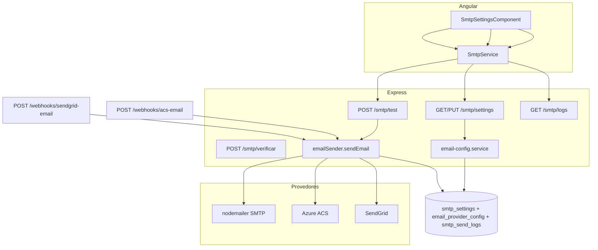

# Módulo Envio de E-mails — Exportação Portável

Documento de referência extraído do projeto **Credenciamento** para reutilizar a configuração e o envio de e-mails (SMTP, Azure Communication Services e SendGrid) em outro projeto.

**Escopo:** settings admin, fachada unificada `emailSender`, logs de envio, webhooks de entrega ACS/SendGrid, verificação e e-mail de teste.

**Relacionado:** templates editáveis — ver [modulo-templates-email.md](./modulo-templates-email.md). Consumidores de domínio (convites, eventos, credenciais) chamam `emailSender.sendEmail` / `smtp.service.sendMail`.

---

## 1. Visão geral e stack

| Camada | Tecnologia |
|--------|------------|
| Frontend | Angular 21 (standalone), Tailwind |
| Backend | Express, MySQL2, Joi, nodemailer, `@azure/communication-email`, `@sendgrid/mail` |
| Secrets | AES-256-GCM (`ENCRYPTION_KEY`) para senha SMTP, connection string ACS, API key SendGrid |
| Permissão RBAC | `settings_smtp` (view / edit) |

**Montagem:**

- `v1Router.use("/smtp", smtpRoutes)` → `/api/v1/smtp`
- `v1Router.use("/webhooks", acsEmailWebhookRoutes)` → `POST /api/v1/webhooks/acs-email`
- `v1Router.use("/webhooks", sendgridEmailWebhookRoutes)` → `POST /api/v1/webhooks/sendgrid-email`

**UI:** `/admin/configuracoes/smtp`.

---

## 2. Arquitetura (fluxo)



---

## 3. Inventário de arquivos

### 3.1 Backend — núcleo (`backend/modules/smtp/`)

| Arquivo | Papel |
|---------|--------|
| `smtp.routes.js` | Rotas admin |
| `smtp.controller.js` | Settings, verify, test, logs + audit |
| `smtp.service.js` | Upsert settings, facade `sendMail`, listagem de logs |
| `smtp.schema.js` | Joi settings + test |
| `emailSender.js` | Envio unificado SMTP/ACS/SendGrid + logs |
| `email-sender.helpers.js` | Rate limit ACS, BCC `ocultar_para`, batch, html→text |
| `email-config.service.js` | Lê/grava provedor; `assertCanSend` |
| `email-provider-config.repository.js` | Persistência `email_provider_config` |
| `acs-email-webhook.routes.js` / `.controller.js` | Event Grid ACS → status entrega |
| `sendgrid-email-webhook.routes.js` / `.controller.js` | Event webhook SendGrid |

### 3.2 Backend — middlewares / suporte

| Arquivo | Papel |
|---------|--------|
| `middleware/event-grid-webhook.middleware.js` | Validação Event Grid ACS |
| `middleware/sendgrid-webhook.middleware.js` | Assinatura webhook SendGrid |
| `config/cryptoSecrets.js` | Secrets criptografados |
| `config/modules.config.js` | `settings_smtp` |

### 3.3 Frontend

| Arquivo | Papel |
|---------|--------|
| `pages/admin/smtp/smtp-settings.component.ts` | Form provedor + logs |
| `services/smtp.service.ts` | HTTP `/smtp/*` |
| Settings shell / menu | `settings-layout`, `SETTINGS_NAV_ITEMS` path `smtp` |
| `config/modules.config.ts` | `settings_smtp` |

### 3.4 Migrations

| Arquivo | Conteúdo |
|---------|----------|
| `003_smtp_teams.sql` | `smtp_settings`, `smtp_send_logs` |
| `035_email_provider_config.sql` | `email_provider_config` + `message_id`/`provider` nos logs + status `entregue`/`bounce` |
| `046_sendgrid_provider.sql` | Colunas SendGrid em `email_provider_config` |

---

## 4. Contratos da API

### 4.1 Admin `/smtp`

| Método | Rota | Auth | Permissão | Função |
|--------|------|------|-----------|--------|
| GET | `/smtp/settings` | JWT | view | Settings públicos (flags `has_*`, sem secrets) |
| PUT | `/smtp/settings` | JWT | edit | Upsert SMTP + provedor |
| POST | `/smtp/verificar` | JWT | edit | `transporter.verify()` (SMTP) |
| POST | `/smtp/test` | JWT | edit | Envia e-mail de teste |
| GET | `/smtp/logs` | JWT | view | Logs paginados (`page`, `limit`, `q`, `status`, `provider`) |

### 4.2 Webhooks (sem JWT)

| Método | Rota | Validação | Função |
|--------|------|-----------|--------|
| POST | `/webhooks/acs-email` | Event Grid middleware | Atualiza status por `message_id` |
| POST | `/webhooks/sendgrid-email` | Assinatura SendGrid | Idem |

### 4.3 Bodies

**PUT `/smtp/settings`** (campos principais):

```json
{
  "provider": "smtp",
  "host": "smtp.exemplo.com",
  "port": 587,
  "secure": false,
  "user": "user@exemplo.com",
  "password": "********",
  "from_email": "noreply@exemplo.com",
  "from_name": "Sistema",
  "acs_connection_string": "",
  "acs_sender": null,
  "sendgrid_api_key": "",
  "sendgrid_from_email": null,
  "sendgrid_from_name": null,
  "sendgrid_webhook_verification_key": "",
  "ocultar_para": false,
  "email_ativo": true
}
```

`provider`: `smtp` | `acs` | `sendgrid`. Secrets são write-only (omitir preserva o salvo).

**POST `/smtp/test`**

```json
{
  "destinatario": "teste@exemplo.com",
  "assunto": "opcional",
  "corpo": "opcional"
}
```

### 4.4 API interna (código)

```js
const { sendEmail, sendMailBatched, getMailSender } = require("./emailSender");

await sendEmail({
  to: "a@b.com",
  subject: "...",
  html: "<p>...</p>",
  text: "...",
  attachments: [],
  usuarioId: 1,
  requestId: req.requestId,
});
```

---

## 5. Schema SQL essencial

```sql
CREATE TABLE IF NOT EXISTS smtp_settings (
  id INT AUTO_INCREMENT PRIMARY KEY,
  host VARCHAR(255) NOT NULL,
  port INT NOT NULL DEFAULT 587,
  secure TINYINT(1) NOT NULL DEFAULT 0,
  user VARCHAR(255) NOT NULL,
  password_ciphertext TEXT NULL,
  from_email VARCHAR(255) NOT NULL,
  from_name VARCHAR(100) NULL,
  ativo TINYINT(1) NOT NULL DEFAULT 1,
  criado_em TIMESTAMP DEFAULT CURRENT_TIMESTAMP,
  atualizado_em TIMESTAMP DEFAULT CURRENT_TIMESTAMP ON UPDATE CURRENT_TIMESTAMP
);

CREATE TABLE IF NOT EXISTS email_provider_config (
  id INT PRIMARY KEY,
  provider VARCHAR(20) NOT NULL DEFAULT 'smtp',
  acs_connection_string_ciphertext TEXT NULL,
  acs_sender VARCHAR(255) NULL,
  sendgrid_api_key_ciphertext TEXT NULL,
  sendgrid_from_email VARCHAR(255) NULL,
  sendgrid_from_name VARCHAR(100) NULL,
  ocultar_para TINYINT(1) NOT NULL DEFAULT 0,
  ativo TINYINT(1) NOT NULL DEFAULT 1,
  atualizado_em TIMESTAMP DEFAULT CURRENT_TIMESTAMP ON UPDATE CURRENT_TIMESTAMP
);

CREATE TABLE IF NOT EXISTS smtp_send_logs (
  id BIGINT AUTO_INCREMENT PRIMARY KEY,
  destinatario VARCHAR(255) NOT NULL,
  assunto VARCHAR(500) NOT NULL,
  corpo_resumo VARCHAR(500) NULL,
  status ENUM('sent', 'failed', 'entregue', 'bounce') NOT NULL,
  erro_mensagem TEXT NULL,
  usuario_id INT NULL,
  request_id VARCHAR(64) NULL,
  message_id VARCHAR(128) NULL,
  provider VARCHAR(20) NULL,
  criado_em TIMESTAMP DEFAULT CURRENT_TIMESTAMP,
  INDEX idx_status (status),
  INDEX idx_criado_em (criado_em),
  INDEX idx_message_id (message_id)
);
```

Há também coluna de chave de verificação do webhook SendGrid (ciphertext) gerida via setup/migrations posteriores — conferir `email-config.service.js` / `setupDatabase.js`.

---

## 6. Variáveis de ambiente

| Variável | Uso |
|----------|-----|
| `ENCRYPTION_KEY` | Criptografa senha SMTP / ACS / SendGrid |
| `ORGANIZATION_NAME` | Assunto/corpo default do e-mail de teste |

Provedores e credenciais ficam no banco.

---

## 7. Dependências

### Backend

- `nodemailer`
- `@azure/communication-email`
- `@sendgrid/mail`
- `joi`, `mysql2`, `express`

### Frontend

- `ApiService` + página settings (sem libs de e-mail no cliente)

---

## 8. Fluxos passo a passo

### A) Salvar configuração

1. Admin escolhe provedor na UI.
2. `PUT /smtp/settings` valida Joi (campos obrigatórios por provedor).
3. Atualiza linha SMTP e/ou singleton `email_provider_config`.

### B) Envio

1. `emailConfigService.assertCanSend()` — exige `email_ativo` + credenciais do provedor.
2. Despacha para SMTP, ACS ou SendGrid.
3. Grava log `sent` ou `failed` com `provider` e `message_id`.

### C) `ocultar_para`

Quando ativo, destinatários reais vão em BCC e o `to` vira o próprio remetente.

### D) Webhooks de entrega

ACS (Event Grid) / SendGrid atualizam `smtp_send_logs.status` para `entregue` ou `bounce` via `updateDeliveryStatus(messageId)`.

---

## 9. Trechos essenciais

### 9.1 Seleção de provedor

```js
if (providerConfig.provider === "acs") {
  result = await sendViaAcs(opts, providerConfig);
} else if (providerConfig.provider === "sendgrid") {
  result = await sendViaSendgrid(opts, providerConfig);
} else {
  result = await sendViaSmtp(opts, providerConfig);
}
```

### 9.2 Rate limit ACS

Envios ACS em lote usam `sendMailBatched` + helper de espera.

### 9.3 Webhooks sem auth JWT

Paths `/webhooks/` não exigem Bearer; segurança = assinatura/validação do provedor.

---

## 10. UI / wiring Angular

| Item | Valor |
|------|--------|
| Rota | `admin/configuracoes/smtp` |
| Componente | `SmtpSettingsComponent` |
| Guard | `settings_smtp` / `view` |
| Menu | `SETTINGS_NAV_ITEMS` → `path: 'smtp'` |
| Service | `SmtpService` |

---

## 11. Checklist de portabilidade

1. **Schema** — `smtp_settings`, `email_provider_config`, `smtp_send_logs` (+ colunas SendGrid).
2. **Env** — `ENCRYPTION_KEY`.
3. **Backend** — copiar `modules/smtp/*` + middlewares de webhook.
4. **Montar rotas** — `/smtp` e `/webhooks`.
5. **RBAC** — `settings_smtp`.
6. **Deps npm** — nodemailer + ACS + SendGrid (ou stubar provedores não usados).
7. **Frontend** — página + service + menu/rota.
8. **Consumidores** — substituir envios ad-hoc por `sendEmail`.
9. **Testes**
   - [ ] Salvar SMTP / ACS / SendGrid
   - [ ] Verificar conexão SMTP
   - [ ] Enviar teste
   - [ ] Ver logs
   - [ ] Webhook atualiza status (se aplicável)

---

## 12. Peculiaridades e armadilhas

1. **Dois níveis de "ativo"** — `smtp_settings.ativo` vs `email_provider_config.ativo` (`email_ativo` na API).
2. **Verificar** só testa SMTP; ACS/SendGrid usam o teste de envio.
3. **Secrets write-only** — UI usa flags `hasPassword`, `has_acs_connection_string`, etc.
4. **SendGrid message id** — webhook pode vir com sufixo `.filter...`; match usa prefixo.
5. **Templates** — este módulo envia HTML/texto prontos; conteúdo editável é outro módulo.

---

## 13. Mapa rápido de cópia

```
backend/
├── modules/smtp/                          ← copiar inteiro
├── middleware/event-grid-webhook.middleware.js
├── middleware/sendgrid-webhook.middleware.js
├── config/cryptoSecrets.js
├── migrations/003_smtp_teams.sql          ← só partes SMTP
├── migrations/035_email_provider_config.sql
└── migrations/046_sendgrid_provider.sql

frontend/
├── pages/admin/smtp/
├── services/smtp.service.ts
└── config/…                               ← menu + modules + rota
```

---

*Gerado a partir do código-fonte do Credenciamento. Fonte da verdade: arquivos listados na seção 3.*
