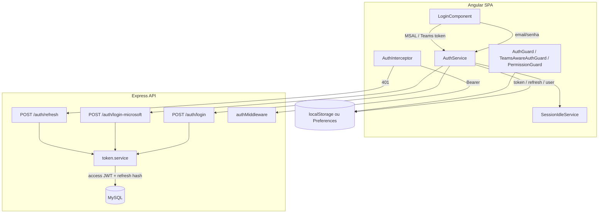

# Módulo de Login / Autenticação — Exportação Portável

Documento de referência extraído do projeto **Credenciamento** para reutilizar o módulo de autenticação em outro projeto (mesma stack Express + Angular, ou como especificação).

**Escopo:** login local, Microsoft (MSAL/Azure), Teams SSO, convite/cadastro de acesso e idle de sessão.

**Não faz parte deste módulo:** fluxo público “esqueci a senha”. Redefinição ocorre via admin (alterar senha) ou novo convite por e-mail.

---

## 1. Visão geral e stack

| Camada | Tecnologia |
|--------|------------|
| Frontend | Angular 21 (standalone), Tailwind 3, MSAL Angular/Browser 5, Teams JS, Capacitor Preferences |
| Backend | Node.js + Express 4, MySQL2, JWT (HS256), JWKS (Microsoft), bcryptjs, Joi |
| Modelo de sessão | Access JWT (Bearer) + refresh opaco (48 bytes hex; hash SHA-256 no MySQL) |
| Cookies | Não usados para auth — apenas `Authorization: Bearer` |

**Montagem da API:** `v1Router.use("/auth", authRoutes)` em `backend/app.js` → base `/api/v1/auth`.

---

## 2. Arquitetura (fluxo)



---

## 3. Inventário de arquivos

### 3.1 Backend — núcleo (`backend/modules/auth/`)

| Arquivo | Papel |
|---------|--------|
| `auth.routes.js` | Rotas `/auth/*` |
| `auth.controller.js` | Controllers + auditoria LOGIN/LOGOUT |
| `auth.service.js` | Login local, login Microsoft, `getMe`, foto Graph |
| `token.service.js` | JWT access, par refresh, revoke |
| `auth.schema.js` | Validação Joi |
| `invite.service.js` | Criar/completar convite empresa (TTL 72h) |

### 3.2 Backend — middlewares

| Arquivo | Papel |
|---------|--------|
| `backend/middleware/authMiddleware.js` | Bearer JWT → `req.user` + roles/permissions |
| `backend/middleware/validateMicrosoftToken.js` | Valida id/access token Azure (JWKS multi-tenant) |
| `backend/middleware/permissionMiddleware.js` | `authorizePermission` / `authorizeAnyPermission` |
| `backend/middleware/rateLimiter.js` | `authLimiter`, `microsoftAuthLimiter` |

### 3.3 Backend — suporte

| Área | Arquivos | Papel |
|------|----------|--------|
| Tenants Azure | `backend/modules/tenants/*` | CRUD + `GET /tenants/msal-config` (público) |
| Usuários | `backend/modules/users/*` | CRUD, senha, `revokeAllUserTokens` |
| Usuários empresa | `backend/modules/company-users/*` | Convites / reenvio |
| Perfis RBAC | `backend/modules/profiles/*` | Perfis + permissões no JWT/`req.user` |
| Sessão | `backend/modules/system-settings/*` | `session_idle_minutes` global |
| Config | `backend/config/env.js`, `setupDatabase.js`, `cryptoSecrets.js` | JWT, seed admin, secrets Azure |
| Utils | `utils/userDepartment.js`, `microsoftGraph.js`, `userProfileSync.js` | Departamento obrigatório, foto, sync AD |
| Observabilidade | `observability/audit.auth.js` | Contexto de auditoria de login |

### 3.4 Frontend

| Arquivo | Papel |
|---------|--------|
| `pages/login/login.component.ts` (+ `.scss`) | Tela login (local + Microsoft + Teams) |
| `layouts/auth-layout.component.ts` (+ `.scss`) | Layout split (Nubank / WTorre) |
| `pages/auth/invite-register.component.ts` | Cadastro via convite (`/cadastro-acesso`) |
| `core/services/auth.service.ts` | Sessão, login, MSAL, Teams, refresh, logout |
| `core/services/session-idle.service.ts` | Idle timeout no cliente |
| `core/services/storage.service.ts` | `localStorage` / Capacitor Preferences |
| `core/interceptors/auth.interceptor.ts` | Bearer + refresh em 401 |
| `core/guards/auth.guard.ts` | Exige token (+ roles opcionais) |
| `core/guards/teams-aware-auth.guard.ts` | Deep link Teams com SSO |
| `core/guards/permission.guard.ts` | Permissão por módulo/ação |
| `services/msal-config.service.ts` | Carrega MSAL de `/tenants/msal-config` |
| `config/msal-runtime.config.ts` | Runtime clientId/authority/redirect |
| `services/teams-context.service.ts` | SSO Teams / popup |
| `public/auth/teams.html` (+ `public/auth/vendor/*`) | Página estática SSO/popup Teams |
| `app.routes.ts` / `app.config.ts` | Rotas e wiring MSAL/interceptors |

### 3.5 Migrations SQL relevantes

| Arquivo | Conteúdo |
|---------|----------|
| `backend/migrations/001_refresh_and_audit.sql` | `refresh_tokens` + `audit_logs` |
| `backend/migrations/012_system_settings.sql` | Settings (incl. sessão) |
| `backend/migrations/016_user_session_idle.sql` | `usuarios.session_idle_minutes` |
| `backend/migrations/020_perfis_permissoes.sql` | Perfis/permissões |
| `backend/migrations/021_drop_usuarios_perfil.sql` | Remove ENUM `perfil` legado |
| `backend/migrations/034_company_users_invite.sql` | `user_invite_tokens` |

DDL também é garantida em bootstrap por `backend/config/setupDatabase.js`.

---

## 4. Contratos da API

Base: `/api/v1`

### 4.1 Rotas `/auth`

| Método | Rota | Auth | Rate limit | Função |
|--------|------|------|------------|--------|
| POST | `/auth/login` | — | `authLimiter` | E-mail/username + senha |
| POST | `/auth/login-microsoft` | Bearer Azure (JWKS) | `microsoftAuthLimiter` | Login Microsoft/Teams |
| POST | `/auth/refresh` | body `refreshToken` | — | Novo access token |
| POST | `/auth/logout` | body opcional `refreshToken` | — | Revoga refresh |
| GET | `/auth/me` | JWT | — | Usuário atual |
| GET | `/auth/profile-photo` | JWT | — | Foto Graph do logado |
| GET | `/auth/users/:id/photo` | JWT | — | Foto de outro usuário |
| GET | `/auth/invite/:token` | — | `authLimiter` | Info do convite |
| POST | `/auth/invite/:token/complete` | — | `authLimiter` | Define senha + login |

### 4.2 Rotas relacionadas

| Método | Rota | Auth | Função |
|--------|------|------|--------|
| GET | `/tenants/msal-config` | público | `clientId`, authority, redirects MSAL |
| GET/PUT | `/system-settings/session` | JWT + permissão | Idle global (5–480 min) |
| CRUD | `/users`, `/company-users` | JWT | Gestão + reenvio de convite |

### 4.3 Bodies e respostas

**POST `/auth/login`**

```json
// request
{ "username": "user@empresa.com", "password": "********" }

// response 200
{
  "auth": true,
  "accessToken": "<jwt>",
  "refreshToken": "<opaque-hex>",
  "token": "<jwt>",
  "user": { /* AuthUser */ }
}
```

**POST `/auth/login-microsoft`**

- Header: `Authorization: Bearer <idToken|accessToken Azure/Teams>`
- Body: `{}` (vazio)
- Response: mesmo formato de login local

**POST `/auth/refresh`**

```json
// request
{ "refreshToken": "<opaque-hex>" }

// response 200
{
  "auth": true,
  "accessToken": "<jwt>",
  "token": "<jwt>",
  "user": { /* AuthUser completo via getMe */ }
}
```

> O refresh **não** devolve novo `refreshToken` (refresh não é rotacionado nesta implementação).

**POST `/auth/logout`**

```json
{ "refreshToken": "<opcional>" }
// → { "auth": false, "message": "Logout realizado." }
```

**POST `/auth/invite/:token/complete`**

```json
{
  "password": "minimo8chars",
  "password_confirm": "minimo8chars"
}
```

Resposta: mesmo formato de login (tokens + user).

**Payload do access JWT**

```json
{
  "id": 1,
  "role": "USER",
  "id_perfil": 2,
  "id_company": null
}
```

Assinado com `JWT_SECRET` (HS256), expiração `JWT_ACCESS_EXPIRES` (default `30m`).

---

## 5. Schema SQL essencial

### 5.1 `usuarios` (núcleo auth)

Campos relevantes (bootstrap + migrations posteriores):

```sql
CREATE TABLE IF NOT EXISTS usuarios (
  id INT AUTO_INCREMENT PRIMARY KEY,
  username VARCHAR(100) NOT NULL,
  nome_completo VARCHAR(200) NOT NULL,
  email VARCHAR(200) NOT NULL UNIQUE,
  departamento VARCHAR(200) NULL,
  senha_hash VARCHAR(255) NULL,
  microsoft_id VARCHAR(64) NULL UNIQUE,
  is_ad_user TINYINT(1) NOT NULL DEFAULT 0,
  id_perfil INT NULL,          -- via migration perfis
  id_company INT NULL,         -- usuários de empresa
  session_idle_minutes INT NULL DEFAULT NULL,
  -- NULL = padrão sistema; 0 = desativado; 5-480 = personalizado
  ativo TINYINT(1) NOT NULL DEFAULT 1,
  criado_em TIMESTAMP DEFAULT CURRENT_TIMESTAMP,
  atualizado_em TIMESTAMP DEFAULT CURRENT_TIMESTAMP ON UPDATE CURRENT_TIMESTAMP
);
```

### 5.2 `refresh_tokens`

```sql
CREATE TABLE IF NOT EXISTS refresh_tokens (
  id INT AUTO_INCREMENT PRIMARY KEY,
  user_id INT NOT NULL,
  token_hash VARCHAR(64) NOT NULL,
  client_type VARCHAR(20) NOT NULL DEFAULT 'web',
  device_info VARCHAR(500) NULL,
  expires_at DATETIME NOT NULL,
  revoked_at DATETIME NULL,
  created_at TIMESTAMP DEFAULT CURRENT_TIMESTAMP,
  INDEX idx_token_hash (token_hash),
  INDEX idx_user_id (user_id),
  FOREIGN KEY (user_id) REFERENCES usuarios(id) ON DELETE CASCADE
);
```

### 5.3 `azure_tenants`

```sql
CREATE TABLE IF NOT EXISTS azure_tenants (
  id INT AUTO_INCREMENT PRIMARY KEY,
  nome VARCHAR(100) NOT NULL,
  azure_tenant_id VARCHAR(64) NOT NULL,
  client_id VARCHAR(64) NOT NULL,
  client_secret_ciphertext TEXT NULL,
  ativo TINYINT(1) NOT NULL DEFAULT 1,
  eh_principal TINYINT(1) NOT NULL DEFAULT 0,
  criado_em TIMESTAMP DEFAULT CURRENT_TIMESTAMP,
  atualizado_em TIMESTAMP DEFAULT CURRENT_TIMESTAMP ON UPDATE CURRENT_TIMESTAMP,
  UNIQUE KEY uk_azure_tenant_id (azure_tenant_id)
);
```

Secrets Azure são criptografados com `ENCRYPTION_KEY` (`cryptoSecrets.js`).

### 5.4 `user_invite_tokens`

```sql
CREATE TABLE IF NOT EXISTS user_invite_tokens (
  id INT AUTO_INCREMENT PRIMARY KEY,
  id_usuario INT NOT NULL,
  token_hash VARCHAR(64) NOT NULL,
  expires_at DATETIME NOT NULL,
  used_at DATETIME NULL,
  criado_em TIMESTAMP DEFAULT CURRENT_TIMESTAMP,
  UNIQUE KEY uk_user_invite_token_hash (token_hash),
  INDEX idx_user_invite_usuario (id_usuario),
  INDEX idx_user_invite_expires (expires_at),
  FOREIGN KEY (id_usuario) REFERENCES usuarios(id) ON DELETE CASCADE
);
```

### 5.5 Sessão e RBAC

```sql
CREATE TABLE IF NOT EXISTS system_settings (
  id INT AUTO_INCREMENT PRIMARY KEY,
  session_idle_minutes INT NOT NULL DEFAULT 30,
  color_palette VARCHAR(32) NOT NULL DEFAULT 'wtorre',
  atualizado_em TIMESTAMP DEFAULT CURRENT_TIMESTAMP ON UPDATE CURRENT_TIMESTAMP
);

-- perfis + perfil_permissoes: ver migration 020_perfis_permissoes.sql
```

---

## 6. Variáveis de ambiente

Extraídas de `backend/.env.example` e `backend/config/env.js`:

| Variável | Uso |
|----------|-----|
| `JWT_SECRET` | Assina access JWT (**obrigatório em produção**) |
| `REFRESH_TOKEN_SECRET` | Exigido em produção pelo `env.js`, mas **não é usado** na geração do refresh (token opaco aleatório + SHA-256) |
| `JWT_ACCESS_EXPIRES` | Default `30m` |
| `JWT_REFRESH_EXPIRES` | Default `7d` (`Nd`/`Nh`/`Nm`/`Ns`) |
| `ENCRYPTION_KEY` | Criptografa secrets Azure/SMTP no DB |
| `ADMIN_EMAIL` / `ADMIN_PASSWORD` | Seed admin no bootstrap |
| `APP_PUBLIC_URL` | Base dos links de convite (`/cadastro-acesso?token=…`) |
| `CORS_ORIGINS` | Origens SPA |
| `MSAL_REDIRECT_URI_WEB` / `_ANDROID` / `_IOS` | Redirects no `msal-config` |
| `RATE_LIMIT_DISABLED` | Desliga rate limit (dev) |
| `RATE_LIMIT_AUTH_MAX` | Default `30` / janela 15 min |
| `RATE_LIMIT_AUTH_WINDOW_MS` | Default `900000` |
| `RATE_LIMIT_MICROSOFT_AUTH_MAX` | Default `40` |
| `TEAMS_ACTIVITY_WEB_URL` | URL https notificações Teams |
| `TEAMS_APP_ID` / `TEAMS_APP_EXTERNAL_ID` | App Teams (opcional) |
| `ORGANIZATION_NAME` | Nome nos e-mails de convite |

Tenants Azure ficam no MySQL (`azure_tenants`), não no `.env`.

Frontend: `environment*.ts` com `apiBaseUrl`; `clientId` real vem de `GET /tenants/msal-config`.

---

## 7. Dependências

### Backend (`backend/package.json`)

- `jsonwebtoken`
- `jwks-rsa`
- `bcryptjs`
- `express-rate-limit`
- `joi`
- `cors`, `helmet`, `dotenv`, `mysql2` (infra)

### Frontend (`frontend/package.json`)

- `@azure/msal-angular` ^5
- `@azure/msal-browser` ^5
- `@microsoft/teams-js` ^2
- `@capacitor/preferences` ^8 (tokens no mobile)

---

## 8. Fluxos passo a passo

### A) Login local

1. UI envia `{ username, password }` → `POST /auth/login`
2. Busca `usuarios` por username/email (`ativo = 1`)
3. Se `is_ad_user` sem `senha_hash` → erro “Use Entrar com Microsoft”
4. `bcrypt.compare` na senha
5. `assertUserCanAccess` (departamento válido, regra de domínio)
6. `createTokenPair` → access JWT + refresh (hash no DB)
7. Frontend grava tokens + `currentUser`, inicia idle, navega (`returnUrl` ou dashboard)

### B) Login Microsoft (web)

1. `GET /tenants/msal-config` → clientId do tenant principal
2. MSAL `loginRedirect` → Azure AD
3. `handleRedirectPromise` → `POST /auth/login-microsoft` com Bearer (idToken)
4. Backend: decode → tenant em `azure_tenants` → audiences permitidas → JWKS RS256
5. Upsert usuário por `microsoft_id` / e-mail (Graph department) → JWT local

### C) Teams SSO

1. `teams-context` inicializa Teams JS; `getAuthToken` (silent ou interativo)
2. Fallback: popup `/auth/teams.html` (vendor MSAL + Teams JS)
3. Mesmo `POST /auth/login-microsoft` com token Teams
4. Deep links usam `TeamsAwareAuthGuard` (SSO antes de exigir sessão)

### D) Refresh / 401

1. Interceptor anexa Bearer em rotas da API (exceto públicas)
2. Em 401: se idle expirado → logout `reason=idle`
3. Senão: uma única chamada `POST /auth/refresh` compartilhada (`shareReplay`)
4. Retry da request; se falhar → logout

Rotas públicas no interceptor: `msal-config`, `/auth/login`, `/auth/refresh`, `/auth/invite`, GET appearance.

### E) Logout

1. Revoga refresh no backend (se houver)
2. Limpa storage / caches MSAL
3. Navega para `/login` (ou `/login?reason=idle`)

### F) Convite empresa

1. Admin cria usuário / reenvia → e-mail com `/cadastro-acesso?token=…` (72h)
2. `GET /auth/invite/:token` → e-mail, empresa, perfil, expiry
3. `POST …/complete` com senha → ativa usuário + tokens (login automático)

### G) Idle de sessão

1. Global: `system_settings.session_idle_minutes` (default 30; min 5; max 480)
2. Override por usuário: `usuarios.session_idle_minutes` (`0` = desativado)
3. Cliente monitora atividade; expiração → `logout({ reason: 'idle' })` → `/login?reason=idle`

---

## 9. Trechos essenciais de código

### 9.1 Rotas (`auth.routes.js`)

```js
const express = require("express");
const authController = require("./auth.controller");
const validateMicrosoftToken = require("../../middleware/validateMicrosoftToken");
const { authMiddleware } = require("../../middleware/authMiddleware");
const { authLimiter, microsoftAuthLimiter } = require("../../middleware/rateLimiter");

const router = express.Router();

router.post("/login", authLimiter, authController.login);
router.post(
  "/login-microsoft",
  microsoftAuthLimiter,
  validateMicrosoftToken,
  authController.loginMicrosoft,
);
router.post("/refresh", authController.refresh);
router.post("/logout", authController.logout);
router.get("/invite/:token", authLimiter, authController.getInvite);
router.post("/invite/:token/complete", authLimiter, authController.completeInvite);
router.get("/me", authMiddleware, authController.me);
router.get("/profile-photo", authMiddleware, authController.profilePhoto);
router.get("/users/:id/photo", authMiddleware, authController.userPhoto);

module.exports = router;
```

### 9.2 Tokens (`token.service.js`)

```js
function hashToken(token) {
  return crypto.createHash("sha256").update(token).digest("hex");
}

async function generateAccessToken(user) {
  const ctx = await profilesService.loadUserProfileContext(user.id);
  const role = ctx?.codigo || user.role || "USER";
  const payload = {
    id: user.id,
    role,
    id_perfil: ctx?.id_perfil || user.id_perfil || null,
    id_company: user.id_company != null ? user.id_company : null,
  };
  return jwt.sign(payload, env.jwtSecret, {
    expiresIn: env.jwtAccessExpires,
  });
}

function generateRefreshToken() {
  return crypto.randomBytes(48).toString("hex");
}

async function createTokenPair(user, req) {
  const accessToken = await generateAccessToken(user);
  const refreshToken = generateRefreshToken();
  const tokenHash = hashToken(refreshToken);
  const expiresAt = getRefreshExpiryDate();
  const clientType = req?.clientType || "web";
  const deviceInfo = req?.headers?.["user-agent"] || null;

  await db.execute(
    `INSERT INTO refresh_tokens (user_id, token_hash, client_type, device_info, expires_at)
     VALUES (?, ?, ?, ?, ?)`,
    [user.id, tokenHash, clientType, deviceInfo, expiresAt],
  );

  return { accessToken, refreshToken };
}
```

### 9.3 Login local — regras (`auth.service.js`)

```js
async function loginLocal(username, password, req) {
  const [users] = await db.execute(
    `SELECT * FROM usuarios WHERE (username = ? OR email = ?) AND ativo = 1 LIMIT 1`,
    [username, username],
  );
  const user = users[0];
  if (!user) throw new AppError("Usuário não encontrado.", 401);
  if (user.is_ad_user === 1 && !user.senha_hash) {
    throw new AppError('Use "Entrar com Microsoft".', 400);
  }
  if (!user.senha_hash) throw new AppError("Senha não definida.", 401);

  const senhaValida = await bcrypt.compare(password, user.senha_hash);
  if (!senhaValida) throw new AppError("Senha incorreta.", 401);

  assertUserCanAccess(user);
  const tokens = await createTokenPair(user, req);
  return await buildAuthResponse(tokens, user);
}
```

### 9.4 Login Microsoft — regras resumidas

1. Extrai `oid`, e-mail (`preferred_username` / `upn` / `email`) e nome do token Azure já validado (`req.azureUser`).
2. Se já existe `microsoft_id` + ativo → emite tokens (caminho Teams sem e-mail).
3. Sem e-mail e sem vínculo → erro pedindo login web ou sync AD.
4. Busca perfil Graph (departamento obrigatório) → upsert por e-mail ou INSERT com perfil default `USER`.
5. Emite par de tokens locais (não reutiliza o JWT da Microsoft nas APIs internas).

### 9.5 Validação Azure (`validateMicrosoftToken.js`) — pontos de atenção

1. Decode JWT completo; exige claims `tid`, `aud`, `oid`.
2. Tenant deve existir em `azure_tenants` (`ativo = 1`).
3. Audiences aceitas:
   - `client_id` do tenant e do principal
   - `api://{clientId}`
   - `api://{hostname}/{clientId}` (SSO Teams)
4. JWKS: `https://login.microsoftonline.com/{tid}/discovery/v2.0/keys`
5. `jwt.verify` com RS256; grava `req.azureUser` e `req.azureTenant`.

### 9.6 Middleware JWT (`authMiddleware.js`)

```js
async function authMiddleware(req, res, next) {
  const authHeader = req.headers.authorization || req.headers.Authorization;
  if (!authHeader || !authHeader.startsWith("Bearer ")) {
    return res.status(401).json({ message: "Token de autenticação não fornecido." });
  }

  const token = authHeader.split(" ")[1];
  try {
    const decoded = verifyAccessToken(token);
    const ctx = await profilesService.loadUserProfileContext(decoded.id);
    if (!ctx || !ctx.ativo) {
      return res.status(403).json({ message: "Usuário inativo ou não encontrado." });
    }
    assertUserCanAccess(ctx);
    req.user = {
      id: ctx.id,
      role: ctx.codigo,
      perfil: ctx.codigo,
      id_perfil: ctx.id_perfil,
      id_company: ctx.id_company,
      is_super_admin: ctx.is_super_admin,
      requires_company: ctx.requires_company,
      profile: { id: ctx.id_perfil, codigo: ctx.codigo, nome: ctx.perfil_nome },
      permissions: ctx.permissions,
    };
    next();
  } catch (err) {
    // AppError → status correspondente; demais → 401
  }
}
```

### 9.7 Schemas Joi

```js
const loginSchema = Joi.object({
  username: Joi.string().required(),
  password: Joi.string().required(),
});

const refreshSchema = Joi.object({
  refreshToken: Joi.string().required(),
});

const logoutSchema = Joi.object({
  refreshToken: Joi.string().optional(),
});

const inviteCompleteSchema = Joi.object({
  password: Joi.string().min(8).max(128).required(),
  password_confirm: Joi.string().valid(Joi.ref("password")).required(),
});
```

### 9.8 Frontend — tipos e sessão (`auth.service.ts`)

```ts
export interface AuthUser {
  id: number;
  username: string;
  nome_completo: string;
  email: string;
  role: string;
  perfil?: string;
  id_perfil?: number | null;
  profile?: UserProfileInfo | null;
  permissions?: string[];
  id_company?: number | null;
  is_ad_user: boolean;
  foto_url?: string;
  session_idle_minutes?: number | null;
  sectorMemberships?: SectorMembership[];
}

export interface AuthSession {
  auth?: boolean;
  accessToken?: string;
  refreshToken?: string;
  token?: string;
  user?: AuthUser;
}

async saveSession(response: AuthSession) {
  const access = response.accessToken || response.token || null;
  const refresh = response.refreshToken || null;
  this.accessTokenCache = access;
  this.refreshTokenCache = refresh;
  if (access) await this.storage.set('token', access);
  if (refresh) await this.storage.set('refreshToken', refresh);
  if (response.user) {
    await this.storage.set('currentUser', JSON.stringify(response.user));
  }
  void this.injector.get(SessionIdleService).resetAfterLogin();
}

loginManual(credentials: { username: string; password: string }) {
  return this.api.post<AuthSession>('/auth/login', credentials).pipe(
    tap((response) => { void this.saveSession(response); }),
  );
}

async refreshSession(): Promise<string | null> {
  const refreshToken =
    this.refreshTokenCache || (await this.storage.get('refreshToken'));
  if (!refreshToken) return null;
  try {
    const res = await firstValueFrom(
      this.api.post<AuthSession>('/auth/refresh', { refreshToken }),
    );
    await this.saveSession(res);
    return res.accessToken || res.token || null;
  } catch {
    return null;
  }
}
```

Microsoft web: `loginMicrosoft()` → MSAL redirect (ou Teams se embedado).  
Teams: `tryTeamsSsoLogin` / `loginMicrosoftInTeams` → `POST /auth/login-microsoft` com Bearer do Teams.

### 9.9 Rotas Angular (trecho)

```ts
{ path: 'login', component: AuthLayoutComponent,
  children: [{ path: '', component: LoginComponent }] },
{ path: 'cadastro-acesso', component: AuthLayoutComponent,
  children: [{ path: '', /* InviteRegisterComponent */ }] },
{ path: 'login/teams-popup', redirectTo: '/auth/teams.html', pathMatch: 'full' },
{ path: '', component: MainLayoutComponent, canActivate: [AuthGuard], children: [ /* ... */ ] },
// Deep links Teams:
// canActivate: [TeamsAwareAuthGuard, PermissionGuard]
```

---

## 10. UI do login

| Tema | Layout |
|------|--------|
| `nubank-parque` | Hero com barras verdes + painel claro; BEM `login-nubank` / `auth-nubank` |
| `wtorre` | Imagem `assets/login.png` + painel azul escuro |

**Classes BEM (Nubank):** `__brand`, `__title`, `__input`, `__submit`, `__ms` (botão Microsoft).

**Tokens:** usar `var(--brand)` / `var(--core-purple)` — nunca hex hardcoded. Paleta ativa via `html[data-theme]`.

Referências de design:

- `.cursor/rules/ui-padrao.mdc`
- `.cursor/rules/ui-tokens.mdc`
- `frontend/src/styles/_tokens.scss`
- `frontend/docs/cores.md`
- `frontend/src/app/pages/login/login.component.scss`
- `frontend/src/app/layouts/auth-layout.component.scss`

---

## 11. Checklist de portabilidade

Ordem sugerida para copiar/adaptar em outro projeto:

1. **Schema** — criar `usuarios`, `refresh_tokens`, `azure_tenants`, `system_settings`, `perfis`/`perfil_permissoes`, `user_invite_tokens` (se convite).
2. **Env** — `JWT_SECRET`, expirations, `ENCRYPTION_KEY`, `APP_PUBLIC_URL`, `CORS_ORIGINS`, redirects MSAL.
3. **Backend núcleo** — copiar `modules/auth/*` + `token.service` + schemas.
4. **Middlewares** — `authMiddleware`, `validateMicrosoftToken`, rate limiters de auth, `permissionMiddleware` (se RBAC).
5. **Montar router** — `app.use("/api/v1/auth", authRoutes)` + `/tenants/msal-config`.
6. **Dependências de domínio** — adaptar ou stubbar:
   - `profilesService.loadUserProfileContext`
   - `assertUserCanAccess` / departamento
   - `sectorsService.listSectorMemberships` (ou remover do `enrichUserResponse`)
   - SMTP para convites
7. **Frontend core** — `AuthService`, `StorageService`, `AuthInterceptor`, `AuthGuard`, `SessionIdleService`.
8. **Páginas** — `LoginComponent`, `AuthLayout`, `InviteRegister` (se aplicável).
9. **MSAL** — `MsalConfigService` + wiring em `app.config.ts` + tenant principal no DB.
10. **Teams** (opcional) — `TeamsContextService`, `teams.html`, `TeamsAwareAuthGuard`, audiences `api://hostname/clientId`.
11. **Idle** — endpoints `/system-settings/session` + preferência por usuário.
12. **Testes manuais**
    - [ ] Login local ok / senha errada / usuário AD sem senha
    - [ ] Refresh após expirar access token
    - [ ] Logout revoga refresh
    - [ ] Login Microsoft (web redirect)
    - [ ] Login Teams SSO / popup
    - [ ] Convite: link → definir senha → sessão criada
    - [ ] Idle: inatividade → `/login?reason=idle`
    - [ ] Rate limit 429 no login

---

## 12. Peculiaridades e armadilhas

1. **`REFRESH_TOKEN_SECRET`** — obrigatório em produção no bootstrap, mas o refresh é **opaco** (não assinado com esse secret). Pode simplificar no projeto destino ou manter por compatibilidade de env.
2. **Refresh sem rotação** — o mesmo refresh vale até expiry/revoke; access é reemitido.
3. **Departamento obrigatório** — usuários internos precisam de `departamento` válido (`userDepartment.js`); ajuste a regra se o outro projeto não tiver essa política.
4. **Duplo campo de token na resposta** — `accessToken` e `token` (alias) para compatibilidade com o frontend.
5. **Sem forgot-password** — só convite ou admin altera senha.
6. **Foto de perfil** — depende de Graph + `client_secret` nos tenants; não é necessária para autenticação básica.
7. **Auditoria** — controllers registram LOGIN/LOGIN_MICROSOFT/LOGOUT; pode ser omitida no port mínimo.

---

## 13. Mapa rápido de cópia

```
backend/
├── modules/auth/                 ← copiar inteiro
├── middleware/
│   ├── authMiddleware.js
│   ├── validateMicrosoftToken.js
│   ├── permissionMiddleware.js   ← se RBAC
│   └── rateLimiter.js            ← ao menos limiters de auth
├── modules/tenants/              ← msal-config + azure_tenants
├── modules/profiles/             ← contexto no JWT
├── modules/system-settings/      ← idle
└── modules/company-users/        ← convites (opcional)

frontend/
├── pages/login/
├── pages/auth/invite-register.component.ts
├── layouts/auth-layout.*
├── core/services/auth.service.ts
├── core/services/session-idle.service.ts
├── core/services/storage.service.ts
├── core/interceptors/auth.interceptor.ts
├── core/guards/auth.guard.ts
├── core/guards/teams-aware-auth.guard.ts   ← se Teams
├── services/msal-config.service.ts
├── services/teams-context.service.ts       ← se Teams
└── public/auth/                            ← se Teams
```

---

*Gerado a partir do código-fonte do Credenciamento. Fonte da verdade: arquivos listados nas seções 3 e 9.*
