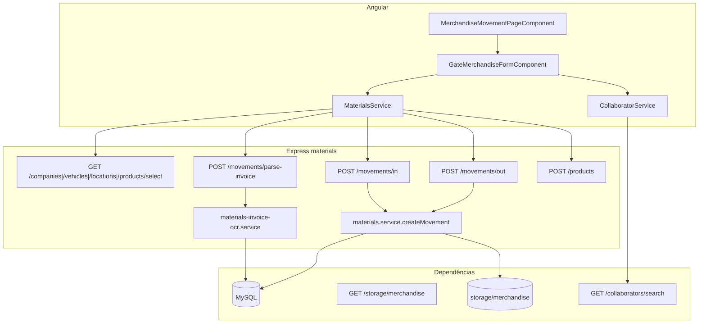

# Módulo Registrar Entrada / Saída de Mercadorias — Exportação Portável

Documento de referência extraído do projeto **Credenciamento** para reutilizar o registro operacional de movimentação de mercadorias na portaria.

**Escopo:** duas permissões RBAC (`merchandise_entry` e `merchandise_exit`) sobre o mesmo backend `modules/materials`: catálogos de select, OCR de NF, cadastro rápido de produto e persistência de entrada/saída (itens, motorista/ajudantes, fotos).

**Não faz parte deste módulo (mas é pré-requisito):** CRUD admin de produtos (`merchandise_products`), locais (`merchandise_locations`) e relatório/estoque (`merchandise_reports`). Cadastros de empresa, frota e colaboradores.

**Relacionado no mesmo backend:** `GET /materials/stock`, `/history` e `/dashboard` — usados pela tela de relatório, não pelas telas de registro.

---

## 1. Visão geral e stack

| Camada | Tecnologia |
|--------|------------|
| Frontend | Angular 21 (standalone), Tailwind, `FormData` + webcam |
| Backend | Express, MySQL2, Joi, Multer (memória), `tesseract.js`, `sharp` (opcional no OCR) |
| Persistência de foto | Disco `backend/storage/merchandise/` + tabela `material_movement_photo` |
| Permissão RBAC | `merchandise_entry` (view / create) · `merchandise_exit` (view / create) |

**Montagem da API:** `v1Router.use("/materials", materialsRoutes)` em `backend/app.js` → base `/api/v1/materials`.

**Fotos:** `v1Router.use("/storage", storageRoutes)` → `GET /api/v1/storage/merchandise?filename=`.

**UI:**

| Rota | Permissão | Tipo |
|------|-----------|------|
| `/mercadorias/entrada` | `merchandise_entry` / view | `ENTRADA` |
| `/mercadorias/saida` | `merchandise_exit` / view | `SAIDA` |

O mesmo componente (`MerchandiseMovementPageComponent` + `GateMerchandiseFormComponent`) é reutilizado; o tipo vem de `route.data.movementType`.

**Perfil típico:** `CONTROLADOR` recebe view+create nas duas permissões (junto com Portaria).

---

## 2. Arquitetura (fluxo)



Fluxo de negócio: **entrada soma estoque**; **saída subtrai** e **bloqueia** se o saldo do par produto+local for insuficiente.

---

## 3. Inventário de arquivos

### 3.1 Backend — núcleo (`backend/modules/materials/`)

| Arquivo | Papel |
|---------|--------|
| `materials.routes.js` | Rotas + RBAC entry/exit vs produtos/locais/relatórios |
| `materials.controller.js` | Controllers + `attachAudit` de movimento |
| `materials.service.js` | Catálogos, `createMovement`, saldo, histórico, dashboard |
| `materials.schema.js` | Joi (payload, itens, queries de relatório) |
| `materials-invoice-ocr.service.js` | OCR Tesseract + match com catálogo de produtos |

### 3.2 Backend — suporte

| Arquivo | Papel |
|---------|--------|
| `backend/middleware/upload.middleware.js` | `merchandisePhotoMiddleware` (1 foto) e `merchandisePhotosMiddleware` (até 10) |
| `backend/modules/storage/storage.routes.js` | Serve arquivos de `storage/merchandise` |
| `backend/modules/collaborators/collaborator.routes.js` | `GET /search` liberado para `merchandise_entry` / `merchandise_exit` view |
| `backend/config/modules.config.js` | Chaves `merchandise_entry` / `merchandise_exit` + perfil CONTROLADOR |
| `backend/observability/audit.policy.js` | Prefixo `/api/v1/materials` → módulo audit `materials` |

### 3.3 Migrations

| Arquivo | Papel |
|---------|--------|
| `014_merchandise.sql` | `storage_location`, `product`, `material_movement`, `material_movement_item` |
| `043_material_movement_collaborator.sql` | Relação motorista + ajudantes |
| `044_material_movement_invoice_number_len.sql` | `invoice_number` VARCHAR(255) (várias NFs concatenadas) |
| `045_material_movement_photo.sql` | Várias fotos por movimentação |

### 3.4 Frontend

| Arquivo | Papel |
|---------|--------|
| `pages/merchandise/merchandise-movement-page.component.ts` | Título/subtítulo por tipo |
| `pages/merchandise/gate-merchandise-form.component.ts` | Formulário operacional |
| `services/materials.service.ts` | HTTP + tipos |
| `config/modules.config.ts` | `merchandise_entry` / `merchandise_exit` |
| `config/sidebar-nav.config.ts` | Menu Mercadorias → Registrar entrada / saída |
| `app.routes.ts` | Rotas + `movementType` |

---

## 4. Contratos da API

Base: `/api/v1/materials` (JWT em todas).

### 4.1 Catálogos (view de entrada **ou** saída)

| Método | Rota | Permissão | Função |
|--------|------|-----------|--------|
| GET | `/companies/select` | entry **ou** exit view | Empresas ativas |
| GET | `/vehicles/select?id_company=` | idem | Veículos ativos da empresa |
| GET | `/locations/select` | idem | Locais ativos |
| GET | `/products/select` | idem | Produtos ativos |

### 4.2 OCR e cadastro rápido

| Método | Rota | Permissão | Função |
|--------|------|-----------|--------|
| POST | `/movements/parse-invoice` | entry/exit view **ou** create | Lê foto da NF; **não persiste** |
| POST | `/products` | `merchandise_products` create **ou** entry/exit create | Alta de produto no ato do lançamento |

OCR: `multipart/form-data`, campo `photo` (JPEG/PNG/WebP, máx. 2 MB).

### 4.3 Registro

| Método | Rota | Permissão | Função |
|--------|------|-----------|--------|
| POST | `/movements/in` | `merchandise_entry` create | Cria movimentação `ENTRADA` |
| POST | `/movements/out` | `merchandise_exit` create | Cria movimentação `SAIDA` |

**Content-Type:** `multipart/form-data`

| Campo | Tipo | Função |
|-------|------|--------|
| `payload` | JSON string | Corpo validado por `movementPayloadSchema` |
| `photos` | arquivo(s) | Até 10 imagens (2 MB cada) |
| `photo` | 1 arquivo | Compat: primeira foto (também aceito) |

**JSON `payload`:**

```json
{
  "id_company": 12,
  "invoice_number": "123456",
  "id_collaborator": 40,
  "id_collaborators": [40, 41],
  "id_vehicle": 7,
  "items": [
    {
      "id_product": 3,
      "id_storage_location": 1,
      "quantity": 10
    }
  ]
}
```

Regras Joi:

- `id_company`, `id_vehicle`, `invoice_number` (1–255) e `items` (≥1) obrigatórios.
- Pelo menos um de `id_collaborator` **ou** `id_collaborators` (mín. 1).
- 1º da lista = motorista; demais = ajudantes. IDs duplicados são unificados.
- Cada item: `id_product`, `id_storage_location`, `quantity` > 0.

**Resposta 201:** `{ "movement": { /* MaterialMovement */ } }`

### 4.4 Fotos

| Método | Rota | Auth | Função |
|--------|------|------|--------|
| GET | `/storage/merchandise?filename=` | JWT | Arquivo da foto |

Query `filename` evita que o Nginx trate a URL como estático.

---

## 5. Schema SQL essencial

```sql
CREATE TABLE IF NOT EXISTS material_movement (
  id_material_movement INT AUTO_INCREMENT PRIMARY KEY,
  movement_type ENUM('ENTRADA', 'SAIDA') NOT NULL,
  id_company INT NOT NULL,
  invoice_number VARCHAR(255) NOT NULL,
  id_collaborator INT NOT NULL,          -- motorista (compat)
  id_vehicle INT NOT NULL,
  photo VARCHAR(255) NULL,               -- 1ª foto (legado)
  id_usuario INT NULL,
  criado_em TIMESTAMP DEFAULT CURRENT_TIMESTAMP,
  FOREIGN KEY (id_company) REFERENCES company(id_company) ON DELETE RESTRICT,
  FOREIGN KEY (id_collaborator) REFERENCES collaborator(id_collaborator) ON DELETE RESTRICT,
  FOREIGN KEY (id_vehicle) REFERENCES vehicle(id_vehicle) ON DELETE RESTRICT,
  FOREIGN KEY (id_usuario) REFERENCES usuarios(id) ON DELETE SET NULL
);

CREATE TABLE IF NOT EXISTS material_movement_item (
  id_material_movement_item INT AUTO_INCREMENT PRIMARY KEY,
  id_material_movement INT NOT NULL,
  id_product INT NOT NULL,
  id_storage_location INT NOT NULL,
  quantity DECIMAL(12, 3) NOT NULL,
  FOREIGN KEY (id_material_movement) REFERENCES material_movement(id_material_movement) ON DELETE CASCADE,
  FOREIGN KEY (id_product) REFERENCES product(id_product) ON DELETE RESTRICT,
  FOREIGN KEY (id_storage_location) REFERENCES storage_location(id_storage_location) ON DELETE RESTRICT
);

CREATE TABLE IF NOT EXISTS material_movement_collaborator (
  id_material_movement_collaborator INT AUTO_INCREMENT PRIMARY KEY,
  id_material_movement INT NOT NULL,
  id_collaborator INT NOT NULL,
  role ENUM('MOTORISTA', 'AJUDANTE') NOT NULL DEFAULT 'AJUDANTE',
  UNIQUE KEY uq_mmc_movement_collaborator (id_material_movement, id_collaborator),
  FOREIGN KEY (id_material_movement) REFERENCES material_movement(id_material_movement) ON DELETE CASCADE,
  FOREIGN KEY (id_collaborator) REFERENCES collaborator(id_collaborator) ON DELETE RESTRICT
);

CREATE TABLE IF NOT EXISTS material_movement_photo (
  id_material_movement_photo INT AUTO_INCREMENT PRIMARY KEY,
  id_material_movement INT NOT NULL,
  filename VARCHAR(255) NOT NULL,
  original_name VARCHAR(255) NULL,
  sort_order INT NOT NULL DEFAULT 0,
  FOREIGN KEY (id_material_movement) REFERENCES material_movement(id_material_movement) ON DELETE CASCADE
);
```

Estoque **não** é tabela: saldo = `SUM(ENTRADA − SAIDA)` por `(id_product, id_storage_location)`.

Cadastros auxiliares (`product`, `storage_location`) nascem em `014_merchandise.sql`.

---

## 6. Variáveis de ambiente

Nenhuma específica deste módulo. OCR usa Tesseract embarcado (`por+eng`). `sharp` é opcional: se o binário falhar no CPU, o OCR segue com o buffer original.

Diretório de fotos: relativo ao backend, `storage/merchandise/` (criado on-write). Garantir volume persistente em deploy.

---

## 7. Dependências

### Backend

- `mysql2`, `express`, `joi`, `multer`
- `tesseract.js` — leitura da NF
- `sharp` — preprocessamento da imagem (rotate/resize/grayscale); fallback silencioso

### Frontend

- `ApiService` (`postFormData` para in/out/OCR)
- `CollaboratorService.search` (CPF na relação)
- `WebcamCaptureModalComponent` (foto da NF)

### Domínio já existente

- `company`, `vehicle` (empresa da NF), `collaborator` (motorista/ajudante, blocklist na UI)
- Produtos e locais ativos

---

## 8. Fluxos passo a passo

### A) Registrar entrada (`ENTRADA`)

1. Usuário com `merchandise_entry` view abre `/mercadorias/entrada`.
2. UI carrega empresas, produtos e locais (`/select`).
3. Escolhe agente → carrega veículos daquela empresa.
4. Busca CPF (≥3 dígitos, debounce 300 ms) em `/collaborators/search`. 1º da lista = motorista; demais = ajudantes. Blocklist é recusada na UI.
5. Opcional: foto da NF (dropzone ou webcam) → `POST /movements/parse-invoice` preenche número e itens (match ≥ 0,55 no catálogo; senão sugere similares).
6. Itens sem produto casado podem ser cadastrados na hora (`POST /products`) se o usuário tiver create em produtos **ou** em entry/exit.
7. Submit: `FormData` com `payload` + `photos`/`photo` → `POST /movements/in`.
8. Service valida empresa/veículo/colaboradores/produtos/locais, grava movimento + itens + relação + fotos, audita `material.movement.in`.

### B) Registrar saída (`SAIDA`)

Igual à entrada, com:

- rota `/mercadorias/saida` e permissão `merchandise_exit` create;
- **antes do INSERT**, para cada item: se saldo &lt; quantidade → `400` (`Saldo insuficiente para "…" em "…"`);
- audit `material.movement.out`.

Não há estorno nem edição de movimentação neste módulo.

### C) OCR (não grava lançamento)

1. Preprocessa imagem (`sharp` se disponível).
2. Tesseract `por+eng`.
3. Extrai número da NF (padrões NF-e / DANFE) e até 40 linhas de item.
4. Faz fuzzy match com produtos ativos (`MATCH_THRESHOLD` 0,55; sugestões a partir de 0,22).
5. Devolve `invoice_number`, `items`, `warnings`, `ocr_preview` (500 chars).

---

## 9. Trechos essenciais

### Payload multipart (controller)

O body JSON vai no campo `payload` (string ou objeto). Joi normaliza `id_collaborators` e define `id_collaborator` = primeiro ID.

### Saldo (saída)

```js
SELECT COALESCE(SUM(
  CASE mm.movement_type WHEN 'ENTRADA' THEN mmi.quantity ELSE -mmi.quantity END
), 0) AS balance
FROM material_movement_item mmi
INNER JOIN material_movement mm ON mm.id_material_movement = mmi.id_material_movement
WHERE mmi.id_product = ? AND mmi.id_storage_location = ?
```

### Auditoria

| Evento | Ação |
|--------|------|
| `material.movement.in` | CREATE |
| `material.movement.out` | CREATE |
| `materials.product.create` | CREATE (alta rápida) |

Resource: `{ type: "material_movement", id }`.

---

## 10. UI / wiring Angular

| Item | Valor |
|------|--------|
| Rotas | `mercadorias/entrada`, `mercadorias/saida` |
| Componente página | `MerchandiseMovementPageComponent` |
| Formulário | `GateMerchandiseFormComponent` (`[movementType]`) |
| Guard | `PermissionGuard` — view da permissão correspondente |
| Menu | grupo `mercadorias` → Registrar entrada / Registrar saída |
| Service | `MaterialsService.registerIn` / `registerOut` / `parseInvoice` |

Campos da tela: agente, número da NF, veículo, relação CPF (motorista/ajudantes), fotos da NF, itens (produto, local, quantidade).

Textos atuais: “Registro de mercadorias que entram no site.” / “…que saem do site.” — adaptar no port.

---

## 11. Checklist de portabilidade

1. **Schema** — migrations 014, 043, 044, 045 (+ tabelas `company`, `vehicle`, `collaborator`, `product`, `storage_location`).
2. **Backend** — copiar `modules/materials/*` e montar em `/api/v1/materials`.
3. **Upload** — `merchandisePhotoMiddleware` / `merchandisePhotosMiddleware`.
4. **Storage** — rota JWT + diretório `storage/merchandise`.
5. **RBAC** — `merchandise_entry` e `merchandise_exit` (view/create). Opcional: products/locations/reports.
6. **Busca de colaborador** — incluir as duas permissões em `GET /collaborators/search`.
7. **Deps** — `tesseract.js`, `sharp`, `multer`.
8. **Frontend** — página + form + `MaterialsService` + rotas com `movementType`.
9. **Testes**
   - [ ] Entrada com 1 item aumenta saldo
   - [ ] Saída com saldo insuficiente retorna 400 e não grava
   - [ ] Saída válida diminui saldo
   - [ ] Veículo de outra empresa é rejeitado
   - [ ] OCR preenche NF quando a foto é legível
   - [ ] Até 10 fotos; arquivo > 2 MB é rejeitado
   - [ ] CONTROLADOR acessa as duas telas; perfil sem create não posta movimento

---

## 12. Peculiaridades e armadilhas

1. **Duas permissões, um código** — a UI é a mesma; só rota, título e endpoint (`/in` vs `/out`) mudam. Quem tem só entrada não deve conseguir postar saída (e vice-versa).
2. **`entryView` / `exitView` nas rotas** — constantes existem em `materials.routes.js` mas **não** são usadas em GET de movimento; catálogo usa `authorizeAnyPermission` das duas views.
3. **Estoque derivado** — não há tabela de saldo; concorrência de duas saídas simultâneas no mesmo par produto+local pode passar do saldo (transação por request, sem lock de linha).
4. **Coluna `photo` + tabela `material_movement_photo`** — a coluna legado guarda o primeiro filename; o restante só na tabela nova. Leitura faz fallback.
5. **OCR é best-effort** — falha de leitura não impede o lançamento; a foto ainda é anexada no submit.
6. **Cadastro rápido de produto** — operador com create em entry/exit pode criar produto mesmo sem `merchandise_products` create. Edição/listagem admin continua só em `merchandise_products`.
7. **Mismatch relatório vs service** — rotas de stock/history/dashboard exigem `merchandise_reports` view; `assertAdmin()` no service exige `merchandise_products` view. No port, alinhar as duas checagens.
8. **Veículo pertence à empresa** — `id_vehicle` deve ser da `id_company` do payload.
9. **Colaborador na movimentação impede exclusão** — `collaborator.service` consulta `material_movement` e `material_movement_collaborator`.
10. **Fotos em disco** — rollback da transação apaga os arquivos recém-gravados; movimento antigo não tem job de limpeza.

---

## 13. Mapa rápido de cópia

```
backend/
├── modules/materials/                 ← copiar inteiro
├── modules/storage/storage.routes.js  ← GET /merchandise
├── middleware/upload.middleware.js    ← merchandisePhoto(s)Middleware
├── storage/merchandise/               ← runtime (gitignored)
└── migrations/
    ├── 014_merchandise.sql
    ├── 043_material_movement_collaborator.sql
    ├── 044_material_movement_invoice_number_len.sql
    └── 045_material_movement_photo.sql

frontend/
├── pages/merchandise/
│   ├── merchandise-movement-page.component.*
│   └── gate-merchandise-form.component.*
├── services/materials.service.ts
└── config/…   ← modules + sidebar + rotas merchandise_entry / merchandise_exit
```

---

*Gerado a partir do código-fonte do Credenciamento. Fonte da verdade: arquivos listados na seção 3.*
