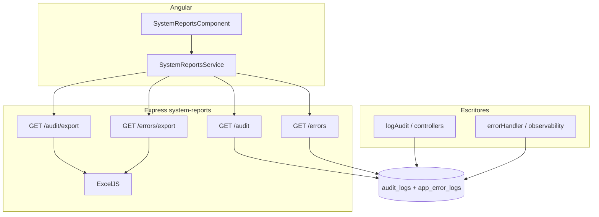

# Módulo Relatórios do Sistema — Exportação Portável

Documento de referência extraído do projeto **Credenciamento** para reutilizar a consulta e exportação de logs de auditoria e erros da aplicação.

**Escopo:** listagem paginada e export Excel de `audit_logs` e `app_error_logs`.

**Não faz parte deste módulo:** relatórios operacionais de negócio (`backend/modules/reports/`, acessos, mercadorias, etc.).

**Dependência:** pipeline de observabilidade que **grava** nessas tabelas (`utils/auditLogger`, error handler / `observability/`).

---

## 1. Visão geral e stack

| Camada | Tecnologia |
|--------|------------|
| Frontend | Angular 21 (standalone), Tailwind |
| Backend | Express, MySQL2, ExcelJS |
| Permissão RBAC | `settings_system_reports` (view) |

**Montagem:** `v1Router.use("/system-reports", systemReportsRoutes)` → `/api/v1/system-reports`.

**UI:** `/admin/configuracoes/relatorios-sistema`.

---

## 2. Arquitetura (fluxo)



---

## 3. Inventário de arquivos

### 3.1 Backend (`backend/modules/system-reports/`)

| Arquivo | Papel |
|---------|--------|
| `system-reports.routes.js` | Rotas + `settings_system_reports` view |
| `system-reports.controller.js` | List + export + audit de EXPORT |
| `system-reports.service.js` | Filtros, paginação, Excel (máx. 10.000 linhas) |

### 3.2 Escritores / suporte

| Área | Arquivos |
|------|----------|
| Audit write | `utils/auditLogger.js`, uso nos controllers |
| Error write | `observability/`, `middleware/errorHandler.js` |
| Migrations | `001_refresh_and_audit.sql` (`audit_logs`), `002_app_error_logs.sql` |
| Modules | `settings_system_reports` em `modules.config` |

### 3.3 Frontend

| Arquivo | Papel |
|---------|--------|
| `pages/admin/system-reports/system-reports.component.ts` | Abas auditoria/erros + filtros + export |
| `services/system-reports.service.ts` | HTTP + download blob Excel |

---

## 4. Contratos da API

Base: `/api/v1/system-reports`

| Método | Rota | Auth | Permissão | Função |
|--------|------|------|-----------|--------|
| GET | `/audit` | JWT | view | Lista paginada |
| GET | `/audit/export` | JWT | view | Excel auditoria |
| GET | `/errors` | JWT | view | Lista paginada |
| GET | `/errors/export` | JWT | view | Excel erros |

### Query params — auditoria

| Param | Tipo | Função |
|-------|------|--------|
| `page` | int | Página (default 1) |
| `limit` | int | Tamanho (default 20) |
| `module` | string | Filtro exato |
| `action` | string | Filtro exato |
| `user_id` | int | Filtro |
| `from` / `to` | `YYYY-MM-DD` | Intervalo `created_at` |

### Query params — erros

| Param | Tipo | Função |
|-------|------|--------|
| `page`, `limit` | int | Paginação |
| `module` | string | Filtro |
| `level` | string | Filtro |
| `status_code` | int | Filtro |
| `from` / `to` | `YYYY-MM-DD` | Intervalo |

### Resposta lista

```json
{
  "items": [ /* ... */ ],
  "pagination": { "page": 1, "limit": 20, "total": 100, "totalPages": 5 }
}
```

### Export

- Content-Type: `application/vnd.openxmlformats-officedocument.spreadsheetml.sheet`
- Content-Disposition: attachment
- Limite: **10.000** linhas (`EXPORT_MAX_ROWS`)
- Export gera audit log `EXPORT` no módulo `system-reports`

---

## 5. Schema SQL essencial

```sql
CREATE TABLE IF NOT EXISTS audit_logs (
  id BIGINT AUTO_INCREMENT PRIMARY KEY,
  user_id INT NULL,
  action VARCHAR(50) NOT NULL,
  module VARCHAR(50) NOT NULL,
  ip VARCHAR(45) NULL,
  client_type VARCHAR(20) NULL,
  request_id VARCHAR(64) NULL,
  metadata JSON NULL,
  created_at TIMESTAMP DEFAULT CURRENT_TIMESTAMP,
  INDEX idx_user_id (user_id),
  INDEX idx_module_action (module, action),
  INDEX idx_created_at (created_at)
);

CREATE TABLE IF NOT EXISTS app_error_logs (
  id BIGINT AUTO_INCREMENT PRIMARY KEY,
  level VARCHAR(10) NOT NULL DEFAULT 'error',
  module VARCHAR(50) NOT NULL,
  message VARCHAR(500) NOT NULL,
  status_code INT NULL,
  user_id INT NULL,
  ip VARCHAR(45) NULL,
  client_type VARCHAR(20) NULL,
  request_id VARCHAR(64) NULL,
  path VARCHAR(255) NULL,
  method VARCHAR(10) NULL,
  stack TEXT NULL,
  metadata JSON NULL,
  created_at TIMESTAMP DEFAULT CURRENT_TIMESTAMP,
  INDEX idx_module (module),
  INDEX idx_status_code (status_code),
  INDEX idx_created_at (created_at),
  INDEX idx_request_id (request_id)
);
```

---

## 6. Variáveis de ambiente

Nenhuma específica deste módulo. Retenção de audit pode existir em jobs (`jobs/` — cron de limpeza); opcional no port mínimo.

---

## 7. Dependências

### Backend

- `exceljs` — export XLSX
- `mysql2`, `express`

### Frontend

- `ApiService` + download de blob (`exportAudit` / `exportErrors`)

---

## 8. Fluxos passo a passo

### A) Consulta

1. UI envia filtros + página.
2. Service monta `WHERE` dinâmico e retorna `items` + `pagination`.
3. `metadata` JSON é parseado quando vem como string.

### B) Export

1. Mesmos filtros, sem paginação (cap 10k).
2. Gera workbook ExcelJS com colunas fixas.
3. Registra audit `EXPORT` e devolve arquivo.

---

## 9. Trechos essenciais

### Colunas Excel — auditoria

`id`, `created_at`, `user_id`, `action`, `module`, `ip`, `client_type`, `request_id`, `metadata`

### Colunas Excel — erros

`id`, `created_at`, `level`, `module`, `message`, `status_code`, `user_id`, `ip`, `client_type`, `request_id`, `path`, `method`, `stack`, `metadata`

---

## 10. UI / wiring Angular

| Item | Valor |
|------|--------|
| Rota | `admin/configuracoes/relatorios-sistema` |
| Componente | `SystemReportsComponent` |
| Guard | `settings_system_reports` / `view` |
| Menu | `SETTINGS_NAV_ITEMS` → `path: 'relatorios-sistema'` |

---

## 11. Checklist de portabilidade

1. **Schema** — `audit_logs`, `app_error_logs`.
2. **Escrita** — portar `logAudit` + error handler que popula `app_error_logs` (senão a UI fica vazia).
3. **Backend** — copiar `modules/system-reports/*`.
4. **Montar** — `/api/v1/system-reports`.
5. **RBAC** — `settings_system_reports`.
6. **Dep** — `exceljs`.
7. **Frontend** — página + service + download.
8. **Testes**
   - [ ] Listar audit após uma ação auditada
   - [ ] Filtrar por módulo/data
   - [ ] Export Excel
   - [ ] Idem para erros (forçar 500 controlado)

---

## 12. Peculiaridades e armadilhas

1. **Só leitura + export** — módulo não configura retenção; limpeza é job separado.
2. **Cap 10k** no export — comunicar na UI se necessário.
3. **Não confundir** com `/api/v1/reports` (operacional).
4. Export de auditoria **gera** novo registro de auditoria (`EXPORT`).

---

## 13. Mapa rápido de cópia

```
backend/
├── modules/system-reports/        ← copiar inteiro
├── utils/auditLogger.js           ← escritor
├── observability/                 ← erros
├── migrations/001_refresh_and_audit.sql  ← audit_logs
└── migrations/002_app_error_logs.sql

frontend/
├── pages/admin/system-reports/
└── services/system-reports.service.ts
```

---

*Gerado a partir do código-fonte do Credenciamento. Fonte da verdade: arquivos listados na seção 3.*
