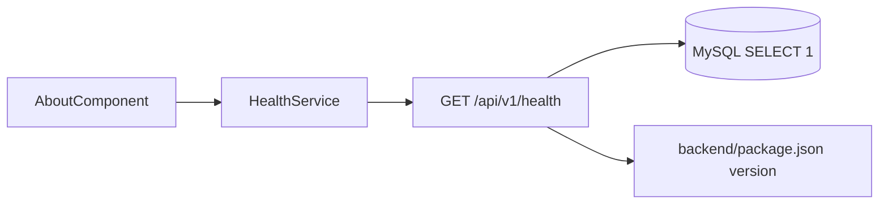

# Módulo Sobre — Exportação Portável

Documento de referência extraído do projeto **Credenciamento** para reutilizar a tela "Sobre" / health check do sistema.

**Escopo:** página admin com versão backend, status API/DB, versão frontend e timestamp; endpoint público de health.

**Não há** módulo backend dedicado em `modules/about` — a UI consome `GET /api/v1/health`.

---

## 1. Visão geral e stack

| Camada | Tecnologia |
|--------|------------|
| Frontend | Angular 21 (standalone), Tailwind |
| Backend | Express + `SELECT 1` no MySQL + `package.json` version |
| Permissão RBAC (UI) | `settings_about` (view) — a rota `/health` em si é **pública** |

**Montagem:** `v1Router.use("/health", healthRoutes)` → `/api/v1/health`.

**UI:** `/admin/configuracoes/sobre`.

---

## 2. Arquitetura (fluxo)



---

## 3. Inventário de arquivos

### 3.1 Backend

| Arquivo | Papel |
|---------|--------|
| `backend/modules/health/health.routes.js` | `GET /` health JSON |

### 3.2 Frontend

| Arquivo | Papel |
|---------|--------|
| `pages/admin/about/about.component.ts` | Tela Sobre |
| `services/health.service.ts` | `getHealth()` |
| Menu / rota | `sobre`, permissão `settings_about` |
| `config/modules.config.ts` | `settings_about` |

### 3.3 Suporte

| Arquivo | Papel |
|---------|--------|
| `backend/config/env.js` | `organizationName` → `appName` na resposta |
| `backend/package.json` | `version` do backend |

---

## 4. Contratos da API

| Método | Rota | Auth | Função |
|--------|------|------|--------|
| GET | `/health` | — | Status da API e DB |

**Resposta 200** (DB ok):

```json
{
  "status": "healthy",
  "db": "ok",
  "appName": "Credenciamento",
  "version": "1.0.0",
  "timestamp": "2026-08-04T14:00:00.000Z",
  "requestId": "..."
}
```

**Resposta 503** (DB falhou):

```json
{
  "status": "degraded",
  "db": "error",
  "appName": "...",
  "version": "...",
  "timestamp": "...",
  "requestId": "..."
}
```

---

## 5. Schema SQL essencial

Nenhum. Apenas conectividade com o pool MySQL existente.

---

## 6. Variáveis de ambiente

| Variável | Uso |
|----------|-----|
| `ORGANIZATION_NAME` | Campo `appName` (default `Credenciamento`) |

Versão backend = campo `version` de `backend/package.json`.  
Versão frontend na UI atual = constante hardcoded `1.0.0` em `AboutComponent`.

---

## 7. Dependências

Nenhuma além de Express + MySQL2 já usados pelo app. Frontend: `ApiService`.

---

## 8. Fluxos passo a passo

1. Usuário com `settings_about` view abre Configurações → Sobre.
2. `reloadPage()` chama `HealthService.getHealth()`.
3. Em erro de rede, a UI mostra status `unavailable` localmente.

Health também pode ser usado por probes de orquestração (Kubernetes/load balancer) sem JWT.

---

## 9. Trechos essenciais

```js
// health.routes.js (resumo)
let dbStatus = "ok";
try {
  await db.execute("SELECT 1");
} catch {
  dbStatus = "error";
}
const status = dbStatus === "ok" ? "healthy" : "degraded";
res.status(dbStatus === "ok" ? 200 : 503).json({
  status,
  db: dbStatus,
  appName: env.organizationName,
  version: packageJson.version,
  timestamp: new Date().toISOString(),
  requestId: req.requestId,
});
```

---

## 10. UI / wiring Angular

| Item | Valor |
|------|--------|
| Rota | `admin/configuracoes/sobre` |
| Componente | `AboutComponent` |
| Guard | `settings_about` / `view` |
| Menu | `SETTINGS_NAV_ITEMS` → `path: 'sobre'` |
| Service | `HealthService` → `GET /health` |

Textos da tela são específicos do Credenciamento (nome, descrição, menção a Azure/SMTP/Teams) — adaptar no port.

---

## 11. Checklist de portabilidade

1. **Backend** — copiar `modules/health/health.routes.js` e montar em `/health`.
2. **Frontend** — página Sobre + `HealthService`.
3. **RBAC** — `settings_about` (só para a rota admin; health permanece público).
4. **Versão FE** — preferir ler de `package.json`/environment em vez de hardcode.
5. **Branding** — trocar nome/descrição da organização.
6. **Testes**
   - [ ] `/health` 200 com DB up
   - [ ] `/health` 503 com DB down
   - [ ] Tela Sobre renderiza versão e status

---

## 12. Peculiaridades e armadilhas

1. **Health público** vs **página protegida** — não confundir; probes não precisam de JWT.
2. **Versão FE hardcoded** — facilmente fica desatualizada.
3. **Shell Configurações** — se o destino não tiver settings layout, a página pode ser rota admin simples.
4. Conteúdo descritivo menciona Teams/Azure — remover se não aplicável.

---

## 13. Mapa rápido de cópia

```
backend/
└── modules/health/health.routes.js

frontend/
├── pages/admin/about/about.component.ts
├── services/health.service.ts
└── config/…   ← menu + modules + rota settings_about
```

---

*Gerado a partir do código-fonte do Credenciamento. Fonte da verdade: arquivos listados na seção 3.*
