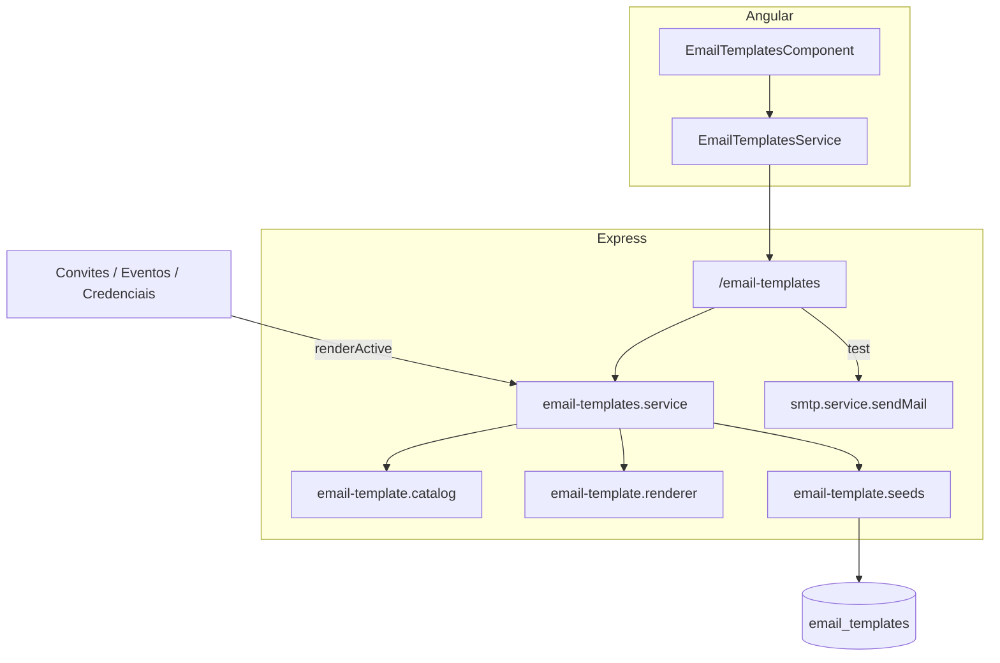

# Módulo Templates de E-mail — Exportação Portável

Documento de referência extraído do projeto **Credenciamento** para reutilizar templates de e-mail editáveis (assunto/HTML/texto + variáveis `{{chave}}`) em outro projeto.

**Escopo:** CRUD por `codigo`, preview, envio de teste, catálogo de variáveis, seeds, renderer e API `renderActive` para consumidores.

**Dependência forte:** [modulo-envio-emails.md](./modulo-envio-emails.md) — o teste de envio usa `smtp.service.sendMail` / `emailSender`.

---

## 1. Visão geral e stack

| Camada | Tecnologia |
|--------|------------|
| Frontend | Angular 21 (standalone), Tailwind |
| Backend | Express, MySQL2, Joi |
| Interpolação | `{{variavel}}` com escape HTML no HTML; plain text sem escape |
| Permissão RBAC | `settings_email_templates` (view / edit) |

**Montagem:** `v1Router.use("/email-templates", emailTemplatesRoutes)` → `/api/v1/email-templates`.

**UI:** `/admin/configuracoes/templates-email`.

---

## 2. Arquitetura (fluxo)



---

## 3. Inventário de arquivos

### 3.1 Backend (`backend/modules/email-templates/`)

| Arquivo | Papel |
|---------|--------|
| `email-templates.routes.js` | Rotas + permissões |
| `email-templates.controller.js` | list/get/update/preview/test + audit |
| `email-templates.service.js` | Persistência, seeds, `renderActive` / `renderDraft` |
| `email-templates.schema.js` | Joi update/preview/test |
| `email-template.catalog.js` | Variáveis documentadas + `sampleVars` por código |
| `email-template.renderer.js` | `interpolate` / `renderFields` / `escapeHtml` |
| `email-template.seeds.js` | Conteúdo default dos templates de sistema |

### 3.2 Frontend

| Arquivo | Papel |
|---------|--------|
| `pages/admin/email-templates/email-templates.component.ts` | Editor + preview + teste |
| `services/email-templates.service.ts` | HTTP client |
| Menu / rota | `templates-email`, permissão `settings_email_templates` |

### 3.3 Migration

| Arquivo | Conteúdo |
|---------|----------|
| `048_email_templates.sql` | Tabela `email_templates` |

### 3.4 Consumidores internos (não copiar, mas adaptar)

| Consumidor | Código template |
|------------|-----------------|
| `auth/invite.service.js` | `invite_access` |
| `events/event.notifications.js` | `event_created`, `event_partner_linked`, `event_partner_complete` |
| `credentials/credentials.service.js` | `credential_approved` |

---

## 4. Contratos da API

Base: `/api/v1/email-templates`

| Método | Rota | Auth | Permissão | Função |
|--------|------|------|-----------|--------|
| GET | `/` | JWT | view | Lista (sem corpos) |
| GET | `/:codigo` | JWT | view | Detalhe + `variables` + `sample_vars` |
| PUT | `/:codigo` | JWT | edit | Atualiza nome/desc/assunto/corpos/ativo |
| POST | `/:codigo/preview` | JWT | view | Renderiza draft ou stored + vars |
| POST | `/:codigo/test` | JWT | edit | Renderiza e envia via SMTP module |

**Não há POST de criação genérica** — códigos vêm do catálogo/seeds (`INSERT IGNORE`).

### Bodies

**PUT `/:codigo`**

```json
{
  "nome": "Convite de acesso",
  "descricao": "Enviado ao convidar usuário",
  "assunto": "Convite — {{organization_name}}",
  "corpo_html": "<p>Olá {{nome}},</p>...",
  "corpo_texto": "Olá {{nome}}...",
  "ativo": true
}
```

**POST `/:codigo/preview`**

```json
{
  "assunto": "opcional override",
  "corpo_html": "opcional",
  "corpo_texto": "opcional",
  "vars": { "nome": "Maria" }
}
```

Vars default = `sampleVars` do catálogo, sobrescritas por `vars`.

**POST `/:codigo/test`**

```json
{
  "destinatario": "teste@exemplo.com",
  "vars": {}
}
```

### API interna

```js
const emailTemplatesService = require("../email-templates/email-templates.service");
const rendered = await emailTemplatesService.renderActive("invite_access", {
  nome: "Maria",
  invite_url: "https://...",
});
// rendered = { subject, html, text } | null (inexistente/inativo)
```

---

## 5. Schema SQL essencial

```sql
CREATE TABLE IF NOT EXISTS email_templates (
  id INT AUTO_INCREMENT PRIMARY KEY,
  codigo VARCHAR(64) NOT NULL,
  nome VARCHAR(150) NOT NULL,
  descricao VARCHAR(500) NULL,
  assunto VARCHAR(500) NOT NULL,
  corpo_html MEDIUMTEXT NOT NULL,
  corpo_texto TEXT NULL,
  ativo TINYINT(1) NOT NULL DEFAULT 1,
  updated_at DATETIME NOT NULL DEFAULT CURRENT_TIMESTAMP ON UPDATE CURRENT_TIMESTAMP,
  updated_by INT NULL,
  UNIQUE KEY uq_email_templates_codigo (codigo),
  KEY idx_email_templates_ativo (ativo)
) ENGINE=InnoDB DEFAULT CHARSET=utf8mb4 COLLATE=utf8mb4_unicode_ci;
```

### Códigos do catálogo (Credenciamento)

| Código | Uso |
|--------|-----|
| `invite_access` | Convite de acesso |
| `event_created` | Evento criado |
| `event_partner_linked` | Parceiro vinculado |
| `event_partner_complete` | Parceiro concluiu cadastro |
| `credential_approved` | Credencial aprovada |

No projeto destino: edite `email-template.catalog.js` + `email-template.seeds.js` para o domínio desejado.

---

## 6. Variáveis de ambiente

Nenhuma específica. Depende de envio configurado ([modulo-envio-emails.md](./modulo-envio-emails.md)) e, nos seeds, de `ORGANIZATION_NAME` / `APP_PUBLIC_URL` nos consumidores.

---

## 7. Dependências

### Backend

- `joi`, `mysql2`, `express`
- Módulo SMTP para `POST .../test`

### Frontend

- `ApiService` + editor HTML simples na página

---

## 8. Fluxos passo a passo

### A) Bootstrap de seeds

Na primeira listagem/get, `ensureSeeds()` faz `INSERT IGNORE` dos seeds — templates de sistema sempre existem.

### B) Editar + preview

1. Admin abre `/:codigo`.
2. Altera HTML com `{{vars}}`.
3. Preview chama `renderDraft` com sample vars.
4. Save → `PUT` + audit `UPDATE` módulo `email_templates`.

### C) Envio de domínio

1. Serviço de domínio monta `vars`.
2. `renderActive(codigo, vars)` — se `null`, fallback local (se o consumidor tiver) ou não envia.
3. `emailSender.sendEmail({ subject, html, text, to })`.

---

## 9. Trechos essenciais

### 9.1 Interpolação

```js
// HTML: valores escapados por padrão
// Texto: rawKeys = todas as chaves (sem escape HTML)
source.replace(/\{\{\s*([a-zA-Z0-9_]+)\s*\}\}/g, ...)
```

Chave ausente → string vazia.

### 9.2 Template inativo

`renderActive` retorna `null` se `ativo = 0` — consumidores devem tratar.

---

## 10. UI / wiring Angular

| Item | Valor |
|------|--------|
| Rota | `admin/configuracoes/templates-email` |
| Componente | `EmailTemplatesComponent` |
| Guard | `settings_email_templates` / `view` |
| Menu | `SETTINGS_NAV_ITEMS` → `path: 'templates-email'` |
| Edit UI | `hasPermission(..., 'settings_email_templates', 'edit')` |

---

## 11. Checklist de portabilidade

1. **Schema** — `email_templates` (migration 048).
2. **Backend** — copiar `modules/email-templates/*`.
3. **Montar** — `/api/v1/email-templates`.
4. **RBAC** — `settings_email_templates` no BE **e** FE `modules.config`.
5. **SMTP** — garantir módulo de envio para teste/consumo.
6. **Adaptar catálogo/seeds** ao domínio do projeto destino.
7. **Frontend** — página + service + menu/rota.
8. **Testes**
   - [ ] Seeds criados no primeiro GET
   - [ ] Preview com variáveis
   - [ ] Save + reload
   - [ ] Test send
   - [ ] Template inativo → `renderActive` null

---

## 12. Peculiaridades e armadilhas

1. **Gap no FE:** `settings_email_templates` existe no backend e nas rotas Angular, mas **falta** em `frontend/src/app/config/modules.config.ts` — a tela de perfis pode omitir esse módulo ao editar permissões. Ao portar, registre nos dois lados.
2. **Sem DELETE/POST create** — só códigos seedados/catalogados.
3. **HTML em `{{invite_url}}` etc.** — URLs no HTML são escapadas (ok para href se o admin colocar o placeholder dentro do atributo com cuidado; preferir texto escapado em conteúdo).
4. **Teste de envio** falha se e-mail estiver desligado no provedor.

---

## 13. Mapa rápido de cópia

```
backend/
├── modules/email-templates/       ← copiar inteiro
├── modules/smtp/                  ← envio (dependência)
└── migrations/048_email_templates.sql

frontend/
├── pages/admin/email-templates/
├── services/email-templates.service.ts
└── config/modules.config.ts       ← settings_email_templates (BE+FE)
```

---

*Gerado a partir do código-fonte do Credenciamento. Fonte da verdade: arquivos listados na seção 3.*
