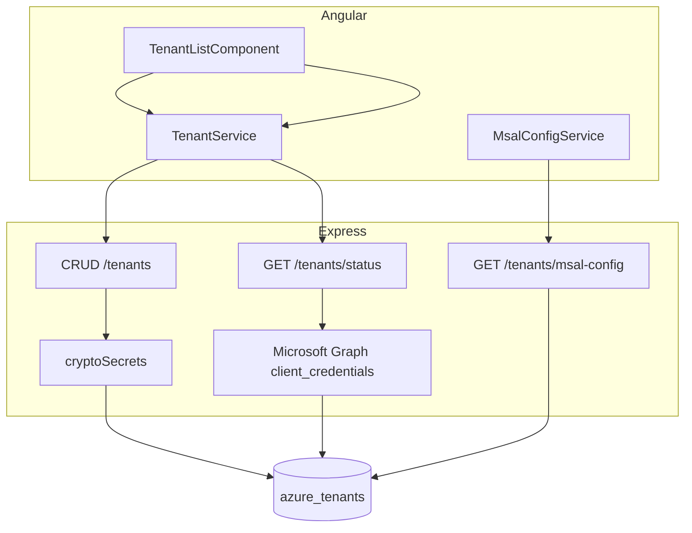

# Módulo Tenants Azure — Exportação Portável

Documento de referência extraído do projeto **Credenciamento** para reutilizar o módulo de cadastro e diagnóstico de tenants Azure AD em outro projeto (mesma stack Express + Angular, ou como especificação).

**Escopo:** CRUD de tenants Azure, endpoint público `msal-config`, teste de conectividade Graph (client credentials), tela admin em Configurações.

**Relacionado:** autenticação Microsoft/Teams — ver [modulo-login.md](./modulo-login.md). Este doc cobre o **CRUD administrativo**; o login consome `GET /tenants/msal-config` e a tabela `azure_tenants`.

---

## 1. Visão geral e stack

| Camada | Tecnologia |
|--------|------------|
| Frontend | Angular 21 (standalone), Tailwind, SweetAlert2 |
| Backend | Node.js + Express 4, MySQL2, Joi, axios, qs |
| Secrets | AES-256-GCM via `ENCRYPTION_KEY` (`cryptoSecrets.js`) |
| Permissão RBAC | `settings_tenants` (view / create / edit / delete) |

**Montagem da API:** `v1Router.use("/tenants", tenantRoutes)` em `backend/app.js` → base `/api/v1/tenants`.

**UI:** `/admin/configuracoes/tenants-azure` (filho de `SettingsLayoutComponent`).

---

## 2. Arquitetura (fluxo)



---

## 3. Inventário de arquivos

### 3.1 Backend — núcleo (`backend/modules/tenants/`)

| Arquivo | Papel |
|---------|--------|
| `tenant.routes.js` | Rotas `/tenants/*` + permissões |
| `tenant.controller.js` | Controllers + auditoria CREATE/UPDATE/DELETE |
| `tenant.service.js` | CRUD, `getMsalConfig`, teste Graph, soft-delete |
| `tenant.schema.js` | Validação Joi create/update |

### 3.2 Backend — suporte

| Área | Arquivos | Papel |
|------|----------|--------|
| Crypto | `backend/config/cryptoSecrets.js` | `encrypt` / `decrypt` do `client_secret` |
| Env | `backend/config/env.js` | `MSAL_REDIRECT_URI_*`, `ENCRYPTION_KEY` |
| Auth MS | `backend/middleware/validateMicrosoftToken.js` | Lê tenants ativos para JWKS/audiences |
| Permissões | `backend/middleware/permissionMiddleware.js` | `authorizePermission` |
| Auth JWT | `backend/middleware/authMiddleware.js` | Bearer → `req.user` |
| Audit | `backend/utils/auditLogger.js` | Log de mutações |
| Modules | `backend/config/modules.config.js` | Entrada `settings_tenants` |
| Bootstrap | `backend/config/setupDatabase.js` | DDL `azure_tenants` |
| Teams bot (opcional) | `modules/teams/bot/adapter.js` | `resetAdapter()` após mutação |

### 3.3 Frontend

| Arquivo | Papel |
|---------|--------|
| `pages/admin/tenants/tenant-list.component.ts` | Dashboard + tabela + modal CRUD |
| `services/tenant.service.ts` | HTTP client `/tenants` |
| `services/msal-config.service.ts` | Consome `msal-config` (login) |
| `layouts/settings-layout.component.ts` | Shell Configurações |
| `config/admin-menu.config.ts` | `SETTINGS_NAV_ITEMS` path `tenants-azure` |
| `config/modules.config.ts` | `settings_tenants` |
| `pages/admin/settings-reloadable.ts` | Contrato `reloadPage()` |
| Shared | `shared/actions/*`, `shared/modal/*` | Ações e modal |

### 3.4 Migrations / DDL

DDL garantida em `setupDatabase.js` (e documentada em [modulo-login.md](./modulo-login.md) §5.3). Não há migration SQL dedicada só a `azure_tenants` no manifesto incremental — a tabela nasce no bootstrap.

---

## 4. Contratos da API

Base: `/api/v1`

| Método | Rota | Auth | Permissão | Função |
|--------|------|------|-----------|--------|
| GET | `/tenants/msal-config` | — | — | `clientId`, authority, redirects |
| GET | `/tenants` | JWT | `settings_tenants` view | Lista |
| GET | `/tenants/:id` | JWT | view | Detalhe (sem secret em claro) |
| POST | `/tenants` | JWT | create | Cria (exige `client_secret`) |
| PUT | `/tenants/:id` | JWT | edit | Atualiza (secret opcional) |
| DELETE | `/tenants/:id` | JWT | delete | Soft-delete (`ativo=0`, `eh_principal=0`) |
| GET | `/tenants/status` | JWT | view | Testa Graph em cada tenant ativo |

### Bodies

**POST `/tenants`**

```json
{
  "nome": "Tenant Corp",
  "azure_tenant_id": "xxxxxxxx-xxxx-xxxx-xxxx-xxxxxxxxxxxx",
  "client_id": "yyyyyyyy-yyyy-yyyy-yyyy-yyyyyyyyyyyy",
  "client_secret": "********",
  "ativo": true,
  "eh_principal": true
}
```

**PUT `/tenants/:id`** — mesmos campos, todos opcionais (mín. 1). `client_secret` vazio/omitido mantém o existente.

**GET `/tenants/msal-config`** — resposta:

```json
{
  "clientId": "...",
  "authority": "https://login.microsoftonline.com/common",
  "redirectUris": { "web": "...", "android": "...", "ios": "..." },
  "redirectUri": "..."
}
```

Seleção do `clientId`: tenant `ativo` + `eh_principal`; fallback = primeiro ativo por `id`.  
`redirectUri` usa `req.clientType` (`web` / `android` / `ios`) quando disponível.

Resposta de listagem **nunca** devolve o secret em claro; expõe `hasSecret: boolean`.

---

## 5. Schema SQL essencial

```sql
CREATE TABLE IF NOT EXISTS azure_tenants (
  id INT AUTO_INCREMENT PRIMARY KEY,
  nome VARCHAR(100) NOT NULL,
  azure_tenant_id VARCHAR(64) NOT NULL,
  client_id VARCHAR(64) NOT NULL,
  client_secret_ciphertext TEXT NULL,
  ativo TINYINT(1) NOT NULL DEFAULT 1,
  eh_principal TINYINT(1) NOT NULL DEFAULT 0,
  criado_em TIMESTAMP DEFAULT CURRENT_TIMESTAMP,
  atualizado_em TIMESTAMP DEFAULT CURRENT_TIMESTAMP ON UPDATE CURRENT_TIMESTAMP,
  UNIQUE KEY uk_azure_tenant_id (azure_tenant_id)
);
```

Regras de negócio:

- No máximo um `eh_principal = 1` (ao marcar principal, zera os demais).
- DELETE é desativação, não remove a linha (preserva FKs de Teams etc.).
- `azure_tenant_id` único → conflito HTTP 409.

---

## 6. Variáveis de ambiente

| Variável | Uso |
|----------|-----|
| `ENCRYPTION_KEY` | Criptografa `client_secret` (**obrigatório em produção**, mín. 32 chars) |
| `MSAL_REDIRECT_URI_WEB` | Redirect web no `msal-config` |
| `MSAL_REDIRECT_URI_ANDROID` | Redirect Android |
| `MSAL_REDIRECT_URI_IOS` | Redirect iOS |

Dados do app Azure (tenant id, client id, secret) ficam no MySQL, não no `.env`.

---

## 7. Dependências

### Backend

- `axios`, `qs` — token OAuth + Graph no status
- `joi` — validação
- Infra: `mysql2`, `express`, crypto nativo + `cryptoSecrets`

### Frontend

- Angular HTTP via `ApiService`
- `sweetalert2` — confirmações na UI
- Shared: actions + modal

---

## 8. Fluxos passo a passo

### A) Listar + status

1. FE chama `GET /tenants` e `GET /tenants/status` em paralelo (`forkJoin`).
2. Status: para cada tenant ativo com secret, obtém token `client_credentials` no tenant e chama `GET https://graph.microsoft.com/v1.0/users?$top=1`.
3. UI mescla cadastro + conectividade (ok / error / inactive / unknown).

### B) Criar tenant

1. Modal → `POST /tenants` com secret obrigatório.
2. Secret criptografado; se `eh_principal`, limpa principal dos outros.
3. Opcional: `resetAdapter()` do bot Teams.

### C) MSAL no login

1. SPA chama `GET /tenants/msal-config` (público).
2. Usa `clientId` + `authority` + `redirectUri` no MSAL Angular.

---

## 9. Trechos essenciais

### 9.1 Rotas

```js
router.get("/msal-config", tenantController.getMsalConfig);
router.get("/status", ...canView, tenantController.status);
router.get("/", ...canView, tenantController.list);
router.post("/", ...canCreate, tenantController.create);
router.put("/:id", ...canEdit, tenantController.update);
router.delete("/:id", ...canDelete, tenantController.remove);
```

### 9.2 `getMsalConfig`

- Authority fixa: `https://login.microsoftonline.com/common`
- Sem tenant ativo → 404 com mensagem orientando cadastro admin

### 9.3 Teste Graph

Escopo: `https://graph.microsoft.com/.default`. Sucesso = HTTP 200 na listagem de users (implica `User.Read.All` ou equivalente no app registration).

---

## 10. UI / wiring Angular

| Item | Valor |
|------|--------|
| Rota | `admin/configuracoes/tenants-azure` |
| Componente | `TenantListComponent` |
| Guard | `PermissionGuard` + `data.permission: { module: 'settings_tenants', action: 'view' }` |
| Menu settings | `SETTINGS_NAV_ITEMS` → `path: 'tenants-azure'` |
| Redirect legado | `/admin/tenants` → `admin/configuracoes/tenants-azure` |
| Sidebar admin | Item "Configurações" (grupo Sistema) mapeia para `settings_tenants` em `SIDEBAR_NAV_GROUPS` |

Implementa `SettingsReloadable.reloadPage()` para recarregar ao trocar aba no shell.

---

## 11. Checklist de portabilidade

1. **Schema** — criar `azure_tenants`.
2. **Env** — `ENCRYPTION_KEY`, redirects MSAL.
3. **Crypto** — copiar `cryptoSecrets.js`.
4. **Backend** — copiar `modules/tenants/*`; montar em `/api/v1/tenants`.
5. **RBAC** — registrar `settings_tenants` em `modules.config` (BE + FE) e perfil admin.
6. **Middlewares** — JWT + `authorizePermission`.
7. **Frontend** — página + `TenantService` + item em settings nav + rota com guard.
8. **Consumidores** — se houver login Microsoft, apontar MSAL para `msal-config` (ver [modulo-login.md](./modulo-login.md)).
9. **Testes manuais**
   - [ ] Criar tenant com secret
   - [ ] Marcar principal / só um principal
   - [ ] Status Graph ok
   - [ ] Soft-delete
   - [ ] `GET /msal-config` público retorna clientId

---

## 12. Peculiaridades e armadilhas

1. **DELETE não apaga** — desativa; FKs (ex.: Teams) permanecem válidas.
2. **Secret write-only** — API não devolve plaintext; update sem secret preserva ciphertext.
3. **Bot Teams opcional** — `require("../teams/bot/adapter")` engolido em try/catch; pode omitir no port.
4. **Teste de status** exige secret + permissão Graph; tenant só com clientId (sem secret) fica com erro "Client secret não configurado".
5. **Authority `common`** — multi-tenant; ajuste se o destino for single-tenant.

---

## 13. Mapa rápido de cópia

```
backend/
├── modules/tenants/              ← copiar inteiro
├── config/cryptoSecrets.js
├── config/env.js                 ← MSAL_* + ENCRYPTION_KEY
├── middleware/authMiddleware.js
├── middleware/permissionMiddleware.js
└── config/modules.config.js      ← settings_tenants

frontend/
├── pages/admin/tenants/
├── services/tenant.service.ts
├── layouts/settings-layout.*     ← se usar shell Configurações
├── config/admin-menu.config.ts   ← SETTINGS_NAV_ITEMS
└── config/modules.config.ts
```

---

*Gerado a partir do código-fonte do Credenciamento. Fonte da verdade: arquivos listados na seção 3.*
